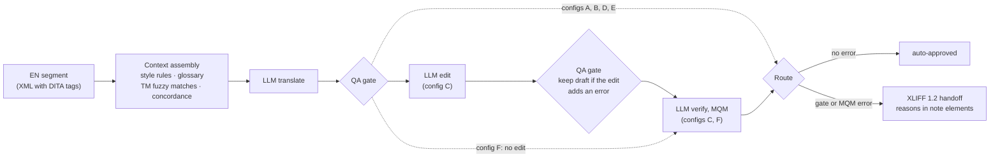

# LLM Localization Pipeline with QA Gates (EN→ZH)

A small, reproducible version of the AI localization workflow that
[Salesforce describes](https://engineering.salesforce.com/how-ai-rebuilt-salesforces-decades-old-localization-pipeline):
context-engineered LLM translation, deterministic QA gates, routing to human
review through XLIFF, and measurement of what each stage is worth. Built on
Salesforce's public help-documentation dataset
([localization-xml-mt](https://github.com/salesforce/localization-xml-mt)).

Personal portfolio project by Yanlin Chen. It uses public data and has not run
in production.

## Results

200 golden segments from the dataset's dev split, each with a professional
reference translation. All configurations use `claude-sonnet-5-5`.

| Config | What the model gets | chrF [95% CI] | UI labels | Terms | Routed to review | $ / 1k words |
|---|---|---|---:|---:|---:|---:|
| A | source only | 57.1 [54.0, 60.4] | 77% | 89% | 6.5% | $0.063 |
| B | + style rules, glossary | 57.6 [54.4, 60.9] | 100% | 98% | 0.5% | $0.077 |
| C | B + AI edit + AI verify | 57.9 [54.6, 61.2] | 100% | 100% | 2.0% | $0.232 |
| D | B + TM fuzzy matches | 61.3 [57.8, 64.9] | 100% | 96% | 1.0% | $0.084 |
| **E** | **D + TM concordance** | **67.3 [63.7, 71.2]** | **100%** | **100%** | **0%** | **$0.121** |
| F | E + AI verify | 67.3 [63.7, 71.2] | 100% | 100% | 1.0% | $0.236 |

- **Context beats bigger models and extra stages.** E scores +10.3 chrF over A
  (95% CI +8.0 to +12.9). Replacing Sonnet 5.5 with Opus 5.5 in config B
  added 0.4 chrF on the tune set at twice the cost.
- **Glossary and style rules buy consistency.** They barely move chrF, but the
  UI labels that match Salesforce's established translation go from 77% to
  100%, and routing to review from 6.5% to 0.5%.
- **The gain is not just reused sentences.** On the 120 golden segments with no
  TM fuzzy match, E still beats A by +8.7 chrF (95% CI +6.3 to +11.5).
- **The AI edit stage was not worth its cost.** In a blind human review of 30
  auto-approved segments, the reviewer preferred C 10 times and E 12 times
  (8 ties), and neither had a major error. E costs about half as much.
- **Routing was precise.** All 7 segments that configurations B-D routed to
  review had a real problem (human-confirmed).

Full numbers: [`reports/results.md`](reports/results.md). Human review:
[`reports/human_review.md`](reports/human_review.md). Recommendation:
[`reports/decision_memo.md`](reports/decision_memo.md).

## How it works



**Context** (`l10n_pipeline/context.py`, `tm.py`). The model receives
structured context, not a bare string:

- **zh-CN style rules** ([`context/style.zh-CN.md`](context/style.zh-CN.md)),
  each backed by counts from the references.
- **Glossary entries found in the segment**, in two scopes:
  - UI labels inside `<uicontrol>`/`<parmname>`, matched as whole labels.
  - Terms in running text.
- **Translation memory**: fuzzy matches (75%+), plus concordance search for
  the most specific phrases of every segment. Concordance is the CAT-tool
  feature that shows earlier approved translations of a phrase.

**Deterministic QA gate** (`l10n_pipeline/qa_gate.py`). The gate is plain
code, so it is free and reproducible. It checks:

- tags: set, nesting, order (order only as a warning);
- protected code text, escaped characters, placeholders, numbers;
- glossary terms and UI labels;
- untranslated prose, length, CJK-Latin spacing.

Each severity was calibrated on the 2,000 dev references
([`reports/gate_calibration.md`](reports/gate_calibration.md)). 8 references
fail, and 6 of those are genuinely broken references.

**Stage guard** ("fix one thing, break another"). The gate runs after every
LLM stage. If the edit stage introduces an error the draft did not have, the
draft is kept.

**Handoff.** Segments with any gate error or major MQM finding go to an
XLIFF 1.2 file for reviewers or vendors:

- DITA tags become `<g>`/`<x>` elements, so CAT tools protect them.
- The state is set to `needs-review-translation`.
- One `<note>` is added per reason.

## Glossary: extraction and human review

`scripts/extract_terms.py` builds candidates from the 98k train segments
without an LLM:

- **UI labels by tag alignment.** The n-th `<uicontrol>` of a source pairs
  with the n-th of its reference. A label is required if one translation
  dominates (90%+).
- **Running-text terms by co-occurrence.** For each candidate phrase, the
  script picks the Chinese string whose segments best match the phrase's
  segments (Dice coefficient). A term is required if references use it 90%+
  of the time.

The reviewer (the author) cut a 96-entry shortlist to 64 entries, split UI-label and
running-text scopes, and listed acceptable alternatives:

- `客户|账户` for Account: the Salesforce object vs a login account.
- An ambiguous entry that lists several options is a closed set the gate
  enforces. One with a single option is guidance only.

On the dev references, 9 of 400 enforced term occurrences fail (2.2%), down
from 12.5% before calibration.

## Iterating like a localization team

Prompts and rules were tuned on a separate 100-segment tune set, never on the
golden set ([`reports/tuning.md`](reports/tuning.md)). The "fix one thing,
break another" cases found along the way:

- **A glossary rule broke code.** The gate demanded 个案 for "Case" inside the
  field reference `[Case].Id`, and the edit stage obeyed. Fix: term matching
  now skips code-like references.
- **Fixing a warning broke a number.** The editor turned a correct `1000 万`
  back into "10 million" to silence a numbers warning. Fix: the editor now
  receives only error-level findings.
- **The glossary contradicted a style rule.** The required entry Account → 客户
  made the editor change correct 关联账户 (login accounts) to 关联客户. Fix:
  Account became a closed set with a usage note.
- **Flat chrF for B and C.** No bugs were found; the translations simply
  lacked Salesforce's established wording. Fix: concordance search (config E).

## Evaluation method

- **Data**:
  - Golden set: 200 segments sampled from the dev split, 50% with tags, after
    removing 164 near-duplicates of train (95%+ similar, which would be TM
    matches rather than MT jobs).
  - Tune set: 100 separate segments.
  - Details: [`data/README.md`](data/README.md).
- **chrF** (sacrebleu): computed on tag-stripped text after Unicode NFKC on
  both sides. The references are NFKC-normalized (half-width `,` `:` `()` but
  full-width `。` `、`), and NFKC on both sides avoids penalizing standard
  full-width punctuation. 95% CIs and paired comparisons use 1,000 bootstrap
  resamples.
- **QA metrics**: computed by re-running the gate on every final target, and
  on the human references as a ceiling.
- **Human review**:
  - Blind pairwise comparison of C and E on 30 random auto-approved segments
    (random X/Y order, no reference shown).
  - A precision check of every routed segment.

## Use it

```bash
python3 -m venv .venv && .venv/bin/pip install -r requirements.txt
.venv/bin/python -I scripts/prepare_data.py       # download data, build golden/tune sets
export ANTHROPIC_API_KEY=...                      # your own key
.venv/bin/python -m l10n_pipeline eval --config E --data data/golden.jsonl --out runs/E
.venv/bin/python -I scripts/evaluate.py --pair E D  # writes reports/results.md
.venv/bin/python -m pytest                        # 98 tests, no API key needed
```

The CLI also reads and writes XLIFF 1.2: Custom Labels in, translations with
QA notes out. Another tool can call it like this (details in
[`docs/interface.md`](docs/interface.md)):

```bash
.venv/bin/python -m l10n_pipeline translate --in labels.xlf --out labels.zh-CN.xlf --content-type ui
```

[lwc-i18n-readiness](https://github.com/PurpleRatzzz/lwc-i18n-readiness), an
i18n readiness gate for Salesforce Lightning Web Components, uses this interface
for its Custom Labels round trip.

The committed `runs/` contain every translated segment behind the numbers
above. Re-running all six configurations costs about $2-3 in API usage. The
whole project, including tuning, cost about $5.

## Repository layout

| Path | Contents |
|---|---|
| `l10n_pipeline/` | units, QA gate, context, TM, LLM client, stages, pipeline, XLIFF, CLI |
| `prompts/` | translate / edit / verify prompts |
| `context/` | style rules and reviewed glossary (`glossary_candidates` = all extracted candidates) |
| `scripts/` | data preparation, term extraction, gate calibration, evaluation, review sheet |
| `data/` | golden and tune sets (CC BY-NC 4.0, see below) |
| `runs/` | outputs and cost summaries of configurations A-F |
| `reports/` | results, human review, decision memo, tuning log, gate calibration |
| `reviews/` | the filled blind review sheet and its key |

## Limitations

- **One reference translation per segment.** chrF measures closeness to
  Salesforce's existing wording, not overall quality, and the human review
  covers 30 segments.
- **A per-string QA gate cannot see sentences assembled in code.**
  [lwc-i18n-readiness](https://github.com/PurpleRatzzz/lwc-i18n-readiness) ran
  its Custom Labels through this pipeline (config E, six runs). All 31 single
  strings were acceptable, with or without upstream context. The 9 failures
  were of two kinds:
  - 6 were sentences that code builds from pieces. For example, dreamhouse's
    "18 days on the market" came back as "18 已上市 天".
  - 3 were a hardcoded imperial unit (miles).

  The gate sent 0 units to review in all six runs, because each piece is fine
  on its own. Fragments have to be stopped upstream or caught in in-context
  review
  ([experiment report](https://github.com/PurpleRatzzz/lwc-i18n-readiness/blob/main/examples/context-experiment/README.md)).
- **Two style decisions knowingly differ from most references**:
  - R11: login accounts are 账户, the current standard form (账 for accounts
    and records). Most dev references use 帐户 (17 vs 6).
  - R13: instructions always start with 请.
  - R13 costs about 0.4 chrF for config B and 0.5 for E. R11 has no
    measurable effect on the golden set: neither 账户 nor 帐户 occurs in its
    references ([`reports/style_cost.md`](reports/style_cost.md)).
- **Possible contamination.** The dataset has been public since 2019, so the
  model may have seen it. This can inflate absolute scores; the comparison
  between configurations uses the same model throughout.
- **Length limits count characters.** A Chinese character is roughly twice as
  wide as a Latin letter, so a character limit is lenient for Chinese. XLIFF
  supports pixel limits, which need font data.
- **Scope.** zh-CN only. The benchmark covers help documentation; UI strings
  were checked only in the small A-B experiment above (31 single strings, one
  judge).

## Next steps

- Build the keep-in-English product-name list from TM statistics. Today 101
  names are kept 90%+ of the time, and some, such as Service Console, vary.
- Apply the human-review findings:
  - lowercase "case" → 个案;
  - limit 贵组织 to "your org";
  - reconcile sample-data handling with house practice.
- Test the verifier with a short context (no TM examples) to cut its cost.
- Run on a second language pair (en-ja is in the dataset).

## License and data

- **Code:** MIT ([`LICENSE`](LICENSE)).
- **Data:** the segments in `data/`, `runs/` and `reviews/` come from
  [salesforce/localization-xml-mt](https://github.com/salesforce/localization-xml-mt),
  Salesforce online help documentation translated by professionals. They
  remain under CC BY-NC 4.0 and are used here non-commercially with
  attribution.

> Kazuma Hashimoto, Raffaella Buschiazzo, James Bradbury, Teresa Marshall,
> Richard Socher, and Caiming Xiong. 2019. A High-Quality Multilingual Dataset
> for Structured Documentation Translation. In *Proceedings of the Fourth
> Conference on Machine Translation (WMT 2019)*, pages 116–127.

The code was written with Claude Code as an AI pair programmer. Design
decisions, the glossary and style review, and the human evaluation are the
author's.
